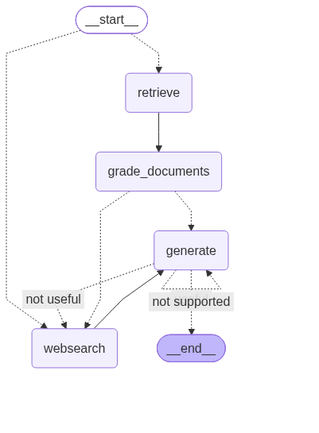

# Agentic RAG with LangGraph

A self-correcting Retrieval-Augmented Generation (RAG) agent built with [LangGraph](https://github.com/langchain-ai/langgraph). It routes each question to a local vector store or to web search. It grades the retrieved documents and checks the answer for hallucinations. Then it checks that the answer actually addresses the question. If any check fails, it retries or falls back to web search.

It combines three ideas from the RAG literature:

- **Adaptive RAG**: routes each question to the source most likely to answer it.
- **Corrective RAG (CRAG)**: grades retrieved documents and adds web search results when some aren't relevant.
- **Self-RAG**: grades the generated answer for grounding and usefulness before returning it.

## Workflow



1. **Route** (`START`): an LLM router sends the question to the **vector store** (for questions about agents, prompt engineering or adversarial attacks on LLMs) or to **web search** (anything else).
2. **Retrieve**: fetches the closest chunks from the Chroma vector store.
3. **Grade documents**: an LLM grader keeps only relevant chunks. If any chunk was irrelevant, it flags that a web search is needed.
4. **Web search**: runs a [Tavily](https://tavily.com) search (top 3 results) and adds the results to the documents.
5. **Generate**: writes a concise answer (three sentences at most) from the documents.
6. **Check generation**:
   - Not grounded in the documents (hallucination) → **regenerate**
   - Grounded but doesn't answer the question → **web search**, then generate again
   - Grounded and useful → **END**

## Project structure

```
.
├── main.py                     # Entry point: runs the graph on a sample question
├── ingestion.py                # Builds the Chroma vector store and exposes the retriever
├── graph/
│   ├── graph.py                # StateGraph: nodes, edges and routing logic
│   ├── state.py                # GraphState (question, generation, web_search, documents)
│   ├── consts.py               # Node names
│   ├── nodes/
│   │   ├── retrieve.py         # Vector store retrieval
│   │   ├── grade_documents.py  # Filters irrelevant documents
│   │   ├── web_search.py       # Tavily web search
│   │   └── generate.py         # Answer generation
│   └── chains/
│       ├── router.py               # Vector store vs. web search router
│       ├── retrieval_grader.py     # Document relevance grader
│       ├── generation.py           # RAG answer chain
│       ├── hallucination_grader.py # Is the answer grounded in the documents?
│       ├── answer_grader.py        # Does the answer address the question?
│       └── tests/test_chains.py    # Tests for the chains
├── graph.png                   # Workflow diagram (regenerated when the graph is built)
└── pyproject.toml
```

## Tech stack

- **Orchestration:** LangGraph, LangChain
- **LLM and embeddings:** accessed through [OpenRouter](https://openrouter.ai) using `langchain-openai` (`openai/gpt-6-luna` for chat, `openai/text-embedding-ada-002` for embeddings)
- **Vector store:** Chroma, stored locally in `.chroma/`
- **Web search:** Tavily
- **Package manager:** [uv](https://docs.astral.sh/uv/)

## Getting started

### Prerequisites

- Python 3.14+
- [uv](https://docs.astral.sh/uv/getting-started/installation/)
- API keys for [OpenRouter](https://openrouter.ai/keys) and [Tavily](https://app.tavily.com)

### 1. Install dependencies

```bash
git clone https://github.com/thesti2/agentic-rag.git
cd agentic-rag
uv sync
```

### 2. Configure environment variables

Create a `.env` file in the project root:

```dotenv
OPENROUTER_API_KEY=your-openrouter-key
TAVILY_API_KEY=your-tavily-key

# Optional: LangSmith tracing
LANGSMITH_TRACING=true
LANGSMITH_ENDPOINT=https://api.smith.langchain.com
LANGSMITH_API_KEY=your-langsmith-key
```

### 3. Build the vector store

The `.chroma/` directory isn't committed, so you need to build it once:

```bash
uv run python ingestion.py
```

This downloads three of Lilian Weng's blog posts and splits them into 250-token chunks. It then embeds the chunks and saves them to `.chroma/`. Running it again rebuilds the collection from scratch, so you won't get duplicates.

- [LLM Powered Autonomous Agents](https://lilianweng.github.io/posts/2023-06-23-agent/)
- [Prompt Engineering](https://lilianweng.github.io/posts/2023-03-15-prompt-engineering/)
- [Adversarial Attacks on LLMs](https://lilianweng.github.io/posts/2023-10-25-adv-attack-llm/)

### 4. Run the agent

```bash
uv run python main.py
```

This runs the graph on the sample question `"what is agent memory?"` and prints the final state. The console output shows each step the agent takes. To ask something else, change the question in `main.py`.

Building the graph also regenerates `graph.png`. That rendering uses the mermaid.ink web service, so it needs an internet connection.

## Tests

```bash
uv run pytest
```

The tests in `graph/chains/tests/` call the LLM and Tavily APIs, so you need valid keys in `.env` to run them.

## Customizing

- **Use your own documents:** edit the `urls` list in `ingestion.py`, then update the router prompt in `graph/chains/router.py` to describe the new topics.
- **Switch models:** change the `model` in each file under `graph/chains/` and in `ingestion.py`. You can use any model available on OpenRouter.
